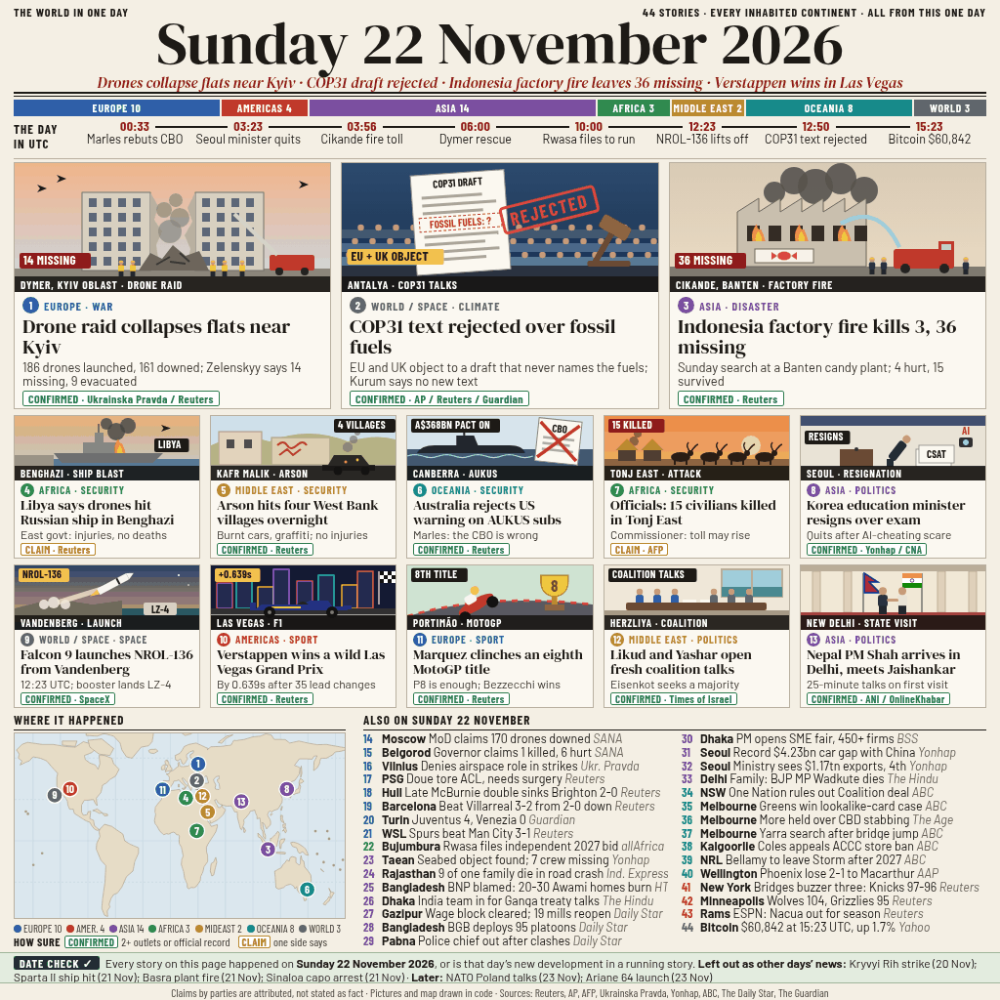

[](https://make.fun/bounty/news-image-20261122?utm_source=github&utm_medium=readme&utm_campaign=news-image-20261122)
[](https://make.fun/bounty/news-image-20261122/leaderboard?utm_source=github&utm_medium=readme&utm_campaign=news-image-20261122)
[](https://make.fun/bounty/news-image-20261122?utm_source=github&utm_medium=readme&utm_campaign=news-image-20261122)

# Sunday 22 November 2026: the world in one image

Code built with **Claude Code**, research done with **Grok Build**, for the make.fun bounty: https://make.fun/r/68mq8j14



**44 date-checked stories, 13 of them pictured, from all 7 regions, all from Sunday 22 November 2026.**

The three leads are the drone raid that brought down flats in Dymer near Kyiv, the COP31 draft that the EU and UK rejected in Antalya, and the candy-factory fire in Cikande, Indonesia, that left 36 people missing. Ten smaller cards cover Libya, South Sudan, the West Bank, Israel, Australia, Korea, India, a Vandenberg launch, Las Vegas and Portimão. 31 one-line briefs fill in the rest. A strip shows the day in UTC, a hand-drawn map places each pictured story, and every item is marked **CONFIRMED** or **CLAIM**. Claims name who is making them.

## How it is made

1. **Research** (`research/r1.json`, `r2.json`, `r3.json`, with notes): three collection passes during the day. Each story has a place, coordinates, source, status and evidence date. The notes list stories left out because they broke on another day (for example the Kryvyi Rih strike on 20 Nov and the Sparta II ship hit on 21 Nov) or had not happened yet.
2. **Data** (`data/stories.json`): the chosen 13 pictured stories, 31 briefs, the timeline and the date-check line.
3. **Pictures** (`illus_a.py`, `illus_b.py`): each scene is a flat inline SVG drawn in Python. There are no photos, logos or external files.
4. **Layout and render** (`build.py`): writes an HTML/SVG page and renders it twice in headless Chrome. It checks that the two renders match, that no text is under 11 px and that nothing overflows, then saves a palette-quantised PNG (1024×1024, about 135 KB).

## Rebuild

```sh
python3 build.py   # writes entry.png (needs google-chrome and Pillow)
python3 main.py    # copies entry.png to $MAKEFUN_OUTPUT_DIR (default /output)
```

MIT licensed (see `LICENSE`). Made with Claude Code and Grok Build: https://make.fun/r/68mq8j14
